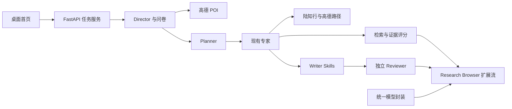

# Phase 4 技术架构与交付计划

Phase 4 将桌面端调研流程延伸到目的地确认、旅行需求收集和可执行决策。沿用独立 Worker、OIDC、三级公会、Agent ID、既有任务状态及 AgentEvent v1。Step 0 交付契约、测试和开发交接。 [产品需求](../PRD.md#phase-4) · [公共接口](phase-4-contract.md)

## 当前基线与目标

| 能力 | 当前 main | Phase 4 需要补齐 |
| --- | --- | --- |
| 任务入口 | 首页提交 `ResearchBrief`，Director 支持文本澄清 | 仅提交目的地，用户确认高德 POI，动态问卷和可选路线轮进入 Planner |
| 旅游规划 | Runtime 已有 `travel_planning`，档案兼容旧 ID；检索仍是网页证据 | 陆知行负责规划，接入真实 POI、地理编码、详情和四种路径，并在桌面地图展示 |
| 专家和报告 | Runtime 名册与前端档案，Writer 整理现有证据，Reviewer 独立审核 | 统一档案与版本化 Skills，Writer 先形成全篇大纲，再生成统一叙事 |
| 实时调研 | 工作台有 Agent/工具/证据事件，模型日志有部分 Usage | 来源生命周期与用量扩展流，桌面三栏、正文详情及可展开动作 |
| 社交研究 | 苏听雨使用一般检索，Evidence 支持 `source_type=social` | 独立 PoC 和可替换适配器，将获准样本归一化后供苏听雨分析 |

### 模块与恢复

- 新 intake 接口写入独立任务输入模式；旧创建入口继续走现有流程。持久化阶段、当前问卷及答复、确认目的地和偏好都按任务归属存放。答复、业务任务状态、幂等响应和续跑指令在同一任务锁事务内提交。后续轮次只从已提交答案触发。
- 有节点或边变化时，集成为支持 Phase 4 intake 的图分配新版本。已有 `durable-v1` 与 `durable-v2` 按原图加载。Checkpoint 只保存 JSON 可恢复数据与稳定引用，适配器和技能注册表由新版 Worker 装配。仅投影租约只补齐已落地的结果和事件，旧 epoch 的写入仍被拒绝。
- Research Browser 数据沿用任务归属、同源代理和 SSE 会话撤销。生产点由检索、评分、报表和模型封装提供。由集成线写入独立事件序号与幂等 ID，实时阶段和最终投影写入共用租约校验，先提交可读资源，再发出引用。扩展流与现有 `/events` 同时使用。
- 模型仍经统一 DeepSeek 封装调用。基础字段、候选确认、出行触发、入库、缓存与去重由确定性规则处理。目的地相关问卷、专家结论与报告使用结构化输出，模型按既有复杂度策略及执行预算选择。技能按阶段加载。POI/路线缓存应包含供应商、模式、起讫点和影响结果的时间/策略，按供应商条款设置有效期。检索和抓取沿用既有归一化与额度控制。
- 新阶段继续复用 `ResearchPlan`、`Evidence`、`ReportDraft` 和 Reviewer 决策；路线可作为有出处的地图证据。外部文本作为不可信数据处理。报告事实引用 Evidence ID，路线图使用已保存的真实路段。

存储边界分两组。A 管理按 `task_id` 关联的 intake 快照和按问卷 ID 关联的已发布轮次及答案，复用既有命令、任务状态与幂等记录。集成管理任务所属路线和来源正文引用，以及独立序号、事件 ID 和租约保护的扩展事件。两组任务资源查询均从任务所有权开始。数据库 DDL 和序号分配在功能接线时落地。

### 公会档案与 Writer

陆知行绑定现有 `travel_planning`。Phase 3 前端已将同一姓名展示在 `tourism_resources` 上，Phase 4 档案将姓名归于旅游规划专家，`tourism_resources` 保留角色头衔、独立职责和现有链接。Planner 保留内部调度角色。执行层始终显示独立 `report_writer` 与 `reviewer`，历史报告和 `writer` 显示别名继续可解析。档案用 `ExpertProfile`，能力通过版本化 `ExpertSkill` 引用注册。

| Writer Skill ID | 输入 | 产出与要求 |
| --- | --- | --- |
| `report_architecture` | 结构化需求、分工及成果概况 | 统一全篇大纲，确定章节目标与顺序 |
| `evidence_synthesis` | 大纲、专家发现、评分及争议 | 按章节形成带出处的综合发现，保留冲突与资料缺口 |
| `editorial_writing` | 大纲及已核查材料 | 统一叙事、语气和章节衔接的 `ReportDraft` |
| `travel_value_orientation` | 草稿、用户优先项、可用路线和限制 | 全局编辑，补足读者可采取的行动，保留引证和不确定性 |

Reviewer 在 Writer 产出完整草稿后独立审核。Reviewer 权限和预算单独配置。专业专家继续沿用现有 Runtime，C 可登记相应技能配置；各专家的工作流调用接入在所属模块完成。

## 外部服务配置

### 高德

| 项目 | 配置所有者 | 约定 |
| --- | --- | --- |
| `AMAP_WEB_API_KEY` | A | 服务端 Web 服务类型 Key，B 复用。申请 POI、地理编码、详情和路径规划权限，检查额度及出口 IP 限制 |
| `NEXT_PUBLIC_AMAP_JS_API_KEY` | 服务端配置 | Web 端 JS API 类型 Key，限制到实际开发和部署域名，由同源配置接口交给地图 |
| `AMAP_SECURITY_JS_CODE` | 服务端配置 | 仅保存在 `backend/.env` 或部署环境，由同源 `/_AMapService` 固定代理注入，浏览器设置 `serviceHost` |

高德控制台分别配置 Web 服务和 JS API 的应用凭据。代理限定高德官方上游和允许的路径，禁止任意转发并屏蔽凭据日志。缺少 JS 配置时可展示已有路线文本。缺少服务端 Key 或配额时按配置、限流或临时错误处理，不生成推测坐标、距离或时间。公交模式使用已核实的起点与终点城市码。 [高德 Web 服务](https://lbs.amap.com/api/webservice/summary) · [路径规划 2.0](https://lbs.amap.com/api/webservice/guide/api/newroute) · [JS API 安全密钥](https://lbs.amap.com/api/javascript-api-v2/guide/abc/jscode)

### MediaCrawler 与替代接入

E 固定 MediaCrawler 上游提交并在独立虚拟环境安装。上游 LICENSE 为 Non-Commercial Learning License 1.1，限定非商业学习与研究，商业使用依赖权利方书面同意。在线采集须按平台确认允许的访问方式、授权和使用范围。账号会话、Cookie 和浏览器资料留在本机私有目录。

TravelMind 的 `SOCIAL_RESEARCH_PROVIDER` 默认 `disabled`。启用 `mediacrawler_export` 后，Worker 可通过本机 Sidecar HTTP 接口或只读文件访问已授权的缓存。Sidecar 负责平台映射、批次状态、分页和缓存。Research Engine 通过冻结的 `SocialEvidence` 转出既有 `Evidence`，苏听雨在原有预算内处理知乎、小红书和 B 站样本。报告继续沿用引用与审核。 [配置与逐平台验收](phase-4-social-research.md)

## 五条分支的修改边界

各线从冻结提交创建独立 Git Worktree。A、C、D、E 同时开工；B 在目的地 Schema 冻结后可依据本契约开工，联调时接入 A 的高德客户端。每线只写下表路径和专属测试/说明。公共 Schema、Fixture 以及文档和公共文件的确需同步变更统一回主会话。按 **A → B → C → D → E** 集成，未满足许可证条件的 E 只合并接口、脱敏测试与 PoC 报告。

| 分支 | 专属文件范围 | 交接及依赖 |
| --- | --- | --- |
| A `feat/dynamic-research-questionnaire` | 后端 `api/intake.py`、`db/intake.py`、`runtime/intake/`、`research/amap_client.py`、`research/amap_poi.py`，intake 专属迁移和测试 | 提供 POI 候选解析、`QuestionnaireDraft → ResearchQuestionnaire`、答复与续跑记录，以及 `ResearchIntakeContext`。高德 HTTP 客户端供 B 复用；D 负责前端首页与问卷界面 |
| B `feat/travel-planning-agent` | 后端 `runtime/travel/`、`research/amap_routes.py`，路线专属测试 | 输入 `Destination`、`TravelPreferences` 及存量专家上下文，产出 `TravelRoute` 和现有 `Evidence`。A 提供基础客户端及 POI 接口；D 用合成路线展示地图 |
| C `feat/expert-skills-report` | 后端 `runtime/skills/`、`runtime/editorial.py`、`expert_profiles/`，技能配置和专项测试 | 技能配置及四个 Writer 技能。沿用 Writer/Reviewer 输入输出，档案和技能引用按冻结结构提供给集成 |
| D `feat/research-browser-ui` | `frontend/` 内首页、工作台、档案、报告详情、样式、地图代理和前端测试 | 只改前端。以共享 Fixture 和离线组件类型完成独立开发。实现首页单字段、可选问卷、地图、三栏工作台和 Hover。真实 OpenAPI 类型集成时统一生成 |
| E `feat/social-research-adapter` | 后端 `research/social/`、`dev/social-research/`、社交适配测试和说明，以及 Research Engine、苏听雨及报告的接线 | 交付本地导入任务、四平台映射、样本治理和阶段验收。苏听雨消费既有 Evidence |

统一集成持有 `main.py`、`config.py`、`.env.example`、Compose、`api/tasks.py`、`db/models.py`、`db/control.py`、`db/worker.py`、`runtime/planning.py`、`state.py`、`workflow.py`、`model.py`、`journal.py`、`projection.py`、`retrieval.py`、公共 Schema、依赖锁和正式生成的前端类型。该阶段接线、挂载新路由、管理 ORM/迁移顺序、选择新旧图、将 A 的结构化需求注入 Planner，并落地路线、来源与 Usage 侧流。A 的迁移接在现有业务 head 后，集成负责后续 route/telemetry 迁移。分支如发现共享文件需改，先在契约或专属服务处明确接口并由主会话接入。

## 验收清单

- **A 问卷**　同名 POI 必须由用户选定，单候选也需确认。首页请求体只有目的地。结构化输出经过 Schema，非法条件与旧轮答案被拒绝。无路线时跳过路线轮，选中路线时可整轮跳过可选项。Worker 重启后恢复同一轮和答案，Planner 分工响应经过校验的需求。
- **B 旅游规划**　以真实高德 Key 核对 POI 详情、地理编码及驾车、公交、步行、骑行实际返回的坐标、距离和耗时。确认 GCJ-02 地图落点、同参数缓存、无公共交通方案及限流处理。模型建议的停留时长与地图测得的通勤时长分开标记。预约及限制回到原始证据。
- **C Skills 与报告**　验证触发、Schema、版本、工具权限与预算。检查只加载当前所需技能、先有全篇大纲再生成章节、报告署名与证据可追溯。独立 Reviewer 可否决草稿，返工仍受原有预算。
- **D 桌面 UI**　用 Fixture 验证三栏、来源状态、正文和外链、工作台 断线续传、事件去重、任务和游标切换，以及缺失 Usage 的展示。真实联调核对 Hover 的安全摘要和供应商计数，流程图中的 Writer、Reviewer 独立可见。地图凭据失效时可读路线文本。
- **E 社交资料**　固定 MediaCrawler 版本，记录 LICENSE、README、四个平台允许的搜索、详情、评论及授权实测结果，区分已验证与受限能力。以允许使用的样本验证去重、聚类、出处、样本范围和缺失字段。正式接入通过相同 `SocialEvidence` 测试，产品构建不包含未获准上游代码。
- **集成与回归**　两用户真实浏览器验收目的地确认、无路线和有路线两次任务、专家并行、三栏 SSE、报告与证据、地图真实路段。验证跨用户访问 404、CSRF、登出双流断开、暂停/重启续跑、旧 epoch 拒写、仅投影租约恢复。现有 Phase 3 入口、老 Checkpoint、AgentEvent v1 客户端、测试、迁移检查及生产构建均通过。
